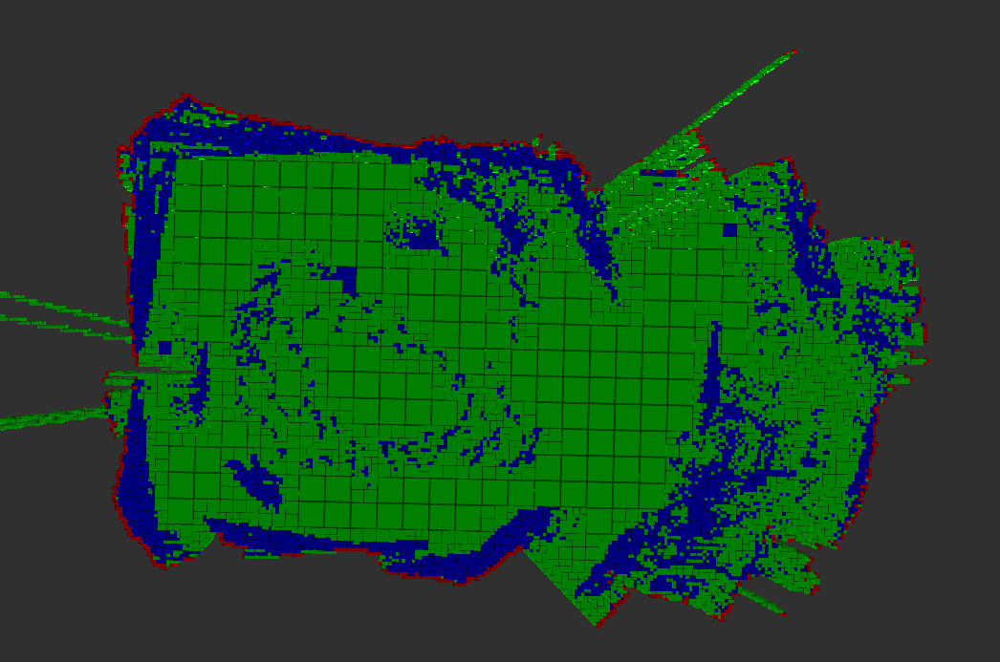
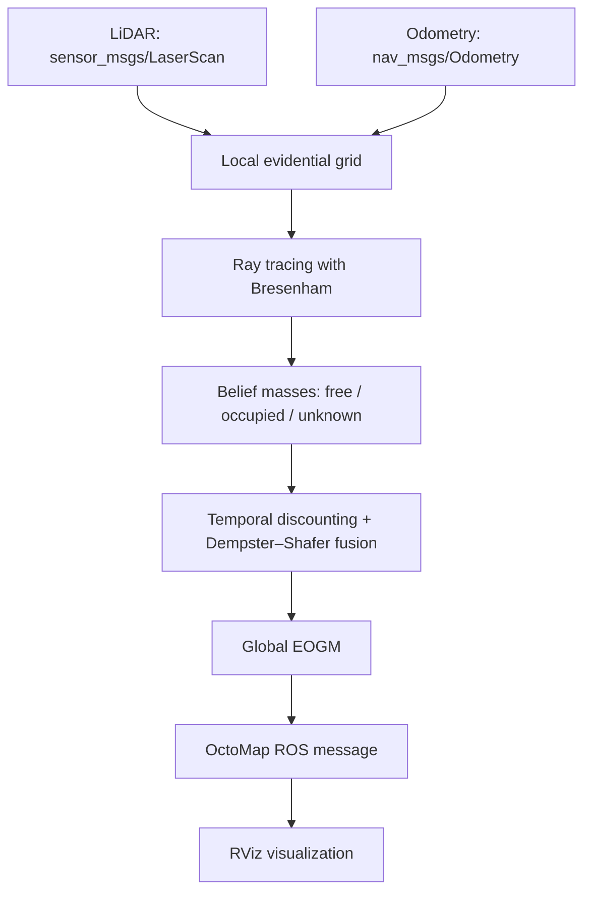

<div align="center">

# 🗺️ Evidential Occupancy Mapping
### Real-time ROS mapping with Dempster–Shafer evidence fusion and AVX2

**Map the world. Keep track of uncertainty.**

A **C++ / ROS 1** robotics project that transforms **LiDAR scans and odometry** into an evolving **evidential occupancy grid map**, combining uncertain observations using **Dempster–Shafer theory** and accelerating computations with **AVX2 SIMD** and **OpenMP**.

[](https://wiki.ros.org/melodic)
[](src/map_fusion/CMakeLists.txt)
[](src/map_fusion/src/common/BeliefMassFunction.cpp)
[](LICENSE)

*An academic robotics project developed at **INSA Rouen Normandie** (2023–2024).*

</div>



*Experimental OctoMap visualization from the project report, produced with a Robotnik Summit-XL robot on the INSA P.E.R.M.I.S. platform. Free, occupied, and conflicting observations can be distinguished in the map.*

## 🔎 Overview

Traditional occupancy grids estimate whether a cell is free or occupied. But real robots must also handle **incomplete observations, conflicting measurements, and moving obstacles**.

This project investigates **Evidential Occupancy Grid Maps (EOGMs)** to represent those uncertainties explicitly. It implements a ROS node that converts consecutive LiDAR measurements into local evidential grids, fuses them into a global map, and publishes the result as an **OctoMap message** for visualization in RViz.

Unlike a conventional binary occupancy map, each cell carries belief masses for **free**, **occupied**, **unknown**, and **conflict** states.

## ✨ Highlights

| Feature | Implementation |
| --- | --- |
| 🧠 **Uncertainty-aware mapping** | Dempster–Shafer belief mass functions capture incomplete and contradictory sensor evidence. |
| 🔄 **Incremental map fusion** | Successive local LiDAR grids are aligned using odometry and fused into a global evidential map. |
| 🚀 **SIMD acceleration** | AVX2 intrinsics process batches of eight single-precision belief mass values. |
| ⚡ **Parallel processing** | OpenMP is used in scan conversion and grid fusion. |
| ⏳ **Temporal discounting** | Older observations are discounted so the map can respond to changing environments. |
| 👀 **ROS / RViz visualization** | Outputs an `octomap_msgs/Octomap` message on `/global_eogm`. |
| 🤖 **Robot evaluation** | Experimentally evaluated with a **Robotnik Summit-XL** and LiDAR/odometry data. |

## 🧩 Processing pipeline



**How the fusion works:**

1. **Observe:** Read a LiDAR scan and the latest odometry.
2. **Rasterize:** Mark free space along each beam and occupied space at the obstacle endpoint.
3. **Assign evidence:** Maintain belief masses for free, occupied, unknown, and conflicting observations.
4. **Fuse:** Combine local evidence with the global map using an evidential combination rule, with temporal discounting of older information.
5. **Publish:** Convert the result into an OctoMap representation usable by ROS tools.

The computation uses **AVX2 vectorization** for belief-mass operations and **OpenMP** for parallelizable portions of the pipeline.

## 📊 Experimental results

The project was evaluated on a **Robotnik Summit-XL**, in a room of approximately **7 × 6 m**, as described in the [project report](report/).

| Observation | Reported outcome |
| --- | --- |
| Mapping | Room boundaries were represented coherently. |
| Dynamic environment | Moving objects were visible in the collected observations. |
| Runtime | Approximately **15 Hz** during the reported experiment. |
| Limitation | IMU/odometry noise produced conflicts near room boundaries. |

> **Performance note:** 15 Hz is an *experimental observation reported in the academic report*, not a universal benchmark or guaranteed rate. Performance depends on map resolution, hardware, and incoming sensor data. AVX2 provides vectorized processing, but no reproducible speedup versus a scalar baseline is claimed.

## 🧰 Tech stack

**C++11 · ROS Melodic · catkin · Dempster–Shafer theory · AVX2 intrinsics · OpenMP · OctoMap · RViz · LiDAR · odometry**

The main code lives in [`src/map_fusion/`](src/map_fusion/), including the [belief-mass implementation](src/map_fusion/src/common/BeliefMassFunction.cpp), [map fusion](src/map_fusion/src/common/EOGM.cpp), and [ROS integration](src/map_fusion/src/EvidentialGrid.cpp).

## 🚀 Build and run

### Requirements

This repository targets a **legacy ROS 1 environment**:

- **Ubuntu 18.04 LTS**
- **ROS Melodic** with catkin and the required ROS packages (including OctoMap, TF2, and ROS C++ libraries)
- An **AVX2-capable x86 CPU** (the build uses `-march=haswell`)

> **Compatibility:** Ubuntu 18.04 and ROS Melodic are end-of-life. Prefer a compatible isolated environment for reproducing the original project. The code has not been verified on newer ROS distributions or ROS 2.

### Compile

```bash
git clone https://github.com/AlixANNERAUD/Evidential_occupancy_map.git
cd Evidential_occupancy_map
source /opt/ros/melodic/setup.bash
catkin_make
source devel/setup.bash
```

### Start the node

Launch the ROS master in one terminal:

```bash
roscore
```

Then, from the project root in another terminal:

```bash
source /opt/ros/melodic/setup.bash
source devel/setup.bash
rosrun map_fusion map_fusion_node
```

The node currently subscribes to `/robot/throttle/odom` and `/robot/throttle/scan`, and publishes the map to `/global_eogm`.

**To use another robot**, adjust the configured topics, grid dimensions, and resolution in [`map_fusion_node.cpp`](src/map_fusion/src/map_fusion_node.cpp), then rebuild. The repository does not currently expose these settings as ROS parameters.

### Visualize with RViz

Start `rviz`, add the appropriate **OctoMap / ColorOccupancyGrid** display (if installed), and select `/global_eogm` with the cell-color display mode. The published frame is `map`.

The report also contains setup notes and an [experimental screenshot](report/images/top_screenshot.png).

## 📁 Repository layout

```text
.
├── src/map_fusion/       # ROS package: sensors, evidential map, AVX2 fusion
├── report/               # Academic report: theory, implementation, experiments
│   └── images/           # Experimental visualization
├── scripts/              # Local build/run and profiling helpers
└── ros-bags/             # Git submodule with ROS bag resources
```

## 🔭 Limitations and future work

This is a **research-oriented academic prototype**, not a production-ready SLAM stack or a complete multi-robot mapping system. Areas discussed in the report include improved localization and IMU filtering, more robust treatment of conflicts, standardized evidential ROS messages, and further performance optimization.

The repository contains its original ROS 1 implementation and research materials to make the experiment inspectable and reproducible where the legacy dependencies are available.

## 🎓 Academic context and credits

Developed as a **third-year engineering project** (*Projet d'approfondissement et d'ouverture*) at [INSA Rouen Normandie](https://www.insa-rouen.fr/), academic year **2023–2024**.

**Authors:** [Alix ANNERAUD](https://alix.anneraud.fr/) and **Dimitri TIMOZ**.

**Acknowledgements:** Hind LAGHMARA HACHEMI for project supervision and Elsa PLANTEROSE for assistance with the INSA P.E.R.M.I.S. robotics platform.

For the theoretical background, methodology, and detailed experimental discussion, see the complete [LaTeX report source](report/).

## 📄 License

Distributed under the [MIT License](LICENSE). Copyright © 2024 Dimitri TIMOZ and Alix ANNERAUD.
